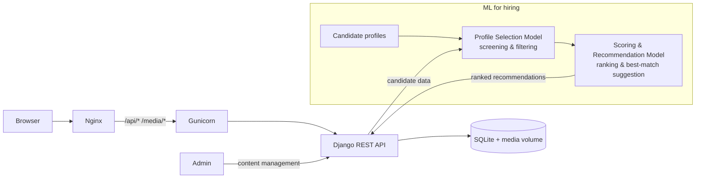

# Zourcing — Full-Stack Landing & Hiring Platform (Showcase)

> Public showcase of a full-stack project. **No source code is published here.** This repository documents the architecture, stack, and engineering practices of a private project. Source code and a live walkthrough are available on request.

## Overview

Zourcing is the public site of a community organization, built as an **Angular single-page application** backed by a **read-only Django REST API**. Administrators maintain the landing content through Django Admin, while public clients can only read published content — the API rejects every write operation from anonymous traffic.

The platform also powers a **machine-learning-driven hiring component** that helps the organization select candidate profiles for recruitment: a **profile selection model** and a **scoring & recommendation model** (see [ML for hiring](#ml-for-hiring)).

## Highlights

- Modern full-stack separation: SPA frontend + content API
- Strict read-only public API (`POST/PUT/PATCH/DELETE` are rejected)
- Admin-authored content model: members, plans, backgrounds, categories, and blog articles
- ML-assisted hiring: automated candidate profile selection, scoring, and recommendation
- Production-grade containers (Gunicorn + Nginx) with a persistent data volume
- Observability built in: Prometheus metrics, JSON structured logs, health checks, optional Sentry tracing

## Stack

| Layer | Technology |
| --- | --- |
| Frontend | Angular 21, TypeScript 5.9, Bootstrap 5, Vitest |
| Backend | Python 3.12, Django 5.2 LTS, Django REST Framework |
| Machine Learning | Candidate profile selection model + scoring & recommendation model |
| Web server | Gunicorn (app) + Nginx (static assets, security headers) |
| Database | SQLite (single-instance deployment) |
| Observability | Prometheus metrics, JSON logs, `/health/`, Sentry (optional) |
| CI/CD | GitHub Actions: lint, tests, audits, builds |

## Architecture

**Key decisions:**

- The public API surface is intentionally read-only; every mutation flows through Django Admin with authenticated staff users.
- The hiring pipeline is split into two specialized models: the **selection model** screens and filters candidate profiles against role requirements, and the **scoring & recommendation model** ranks the surviving profiles and suggests the best matches — keeping each model focused, testable, and independently tunable.
- The historical production database was replaced with curated fixtures because it contained authentication and session records — content and media were preserved, credentials were not.
- Configuration is environment-driven and **fails closed**: startup refuses to run without a unique `DJANGO_SECRET_KEY` when debug is disabled.
- Anonymous API traffic is rate-limited (120 requests/minute/client), and static assets carry browser security headers through Nginx.

## ML for hiring

| Model | Purpose |
| --- | --- |
| **Profile Selection Model** | Screens the candidate pool and selects the profiles that match a role's requirements, reducing manual review to a relevant shortlist |
| **Scoring & Recommendation Model** | Assigns each selected profile a score and produces a ranked recommendation list, so recruiters focus on the strongest candidates first |

The two models form a pipeline: selection narrows the pool, scoring ranks it. Results surface through the admin side of the platform, keeping the public landing API untouched and read-only.

## Quality gates (run in CI)

- Backend: `ruff` (format + lint), pytest with **≥ 85% statement coverage**, `pip-audit` on the frozen dependency export
- Frontend: ESLint, Vitest with **90% coverage on service tests** plus component state-transition tests, strict TypeScript/template build, `npm audit --audit-level=high`
- Dependency workflow: `uv` with a frozen lockfile for reproducible installs

## Operations

- `GET /health/` — database readiness check
- `GET /metrics` — Prometheus application metrics
- JSON logs on stdout, ready for any log aggregator
- Idempotent content seeding command to restore curated public content
- Documented runbook for deployment and recovery procedures

## Skills demonstrated

Angular 21 / TypeScript, Django 5.2 / DRF, REST API design, machine learning productization (selection, scoring & recommendation models), Docker & docker-compose, Nginx, CI pipelines, automated testing strategy, application security (rate limiting, security headers, fail-closed configuration), observability, operational runbooks.

---

*This is a documentation-only showcase. The private repository contains the full implementation: Angular client, Django project, ML pipeline, tests, CI workflows, and infrastructure configuration.*
